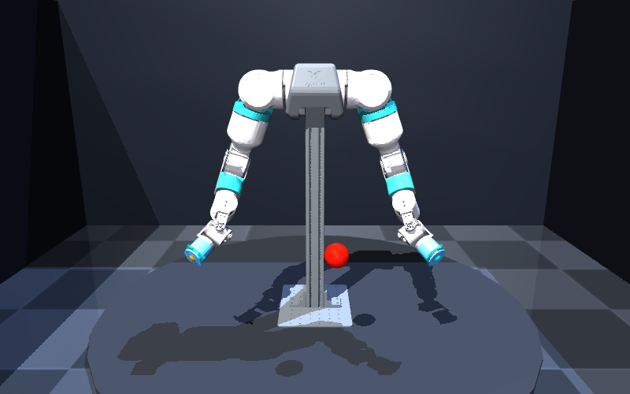
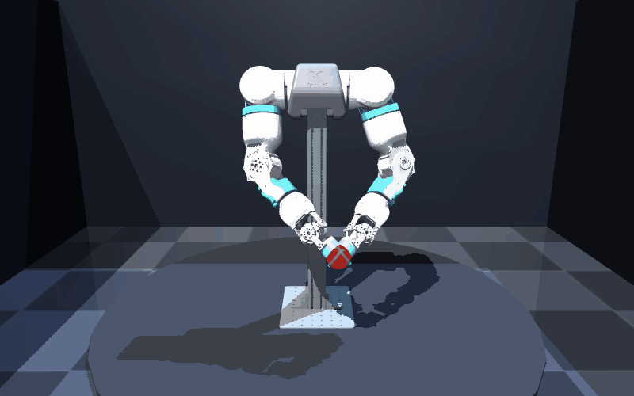

# OpenArmX MuJoCo — Dual-arm control experiments

**Explore OpenArmX dual-arm robotics in MuJoCo: interactive inverse kinematics, impedance control, cooperative manipulation, and nonlinear model predictive cooperative control (NMPCC).**

**OpenArmX 双臂机器人仿真实验：从可交互逆运动学，到阻抗控制、协同搬运和基于 acados 的非线性模型预测协同控制。**

[Quick start / 快速开始](#quick-start--快速开始) · [Experiment map / 实验导航](#experiment-map--实验导航) · [Troubleshooting / 运行排障](#first-run-troubleshooting--首次运行排障) · [Feedback / 使用反馈](https://github.com/Marco0431/openarmx_mujoco/issues/new/choose)

| Included model / 仓库模型 | Shared-target IK / 双臂跟随目标 |
| :---: | :---: |
|  |  |

Actual MuJoCo renders of the included assets. The 5-second GIF uses `ik.py`'s position solver with an automatically moving target: a kinematic demonstration, not a dynamics benchmark or hardware recording. [How these previews are generated](docs/README.md).

以上由仓库真实模型在 MuJoCo 中渲染。右侧为 5 秒自动目标运动与现有 IK 求解器的演示，直接更新关节位置，不代表动力学性能或实机验证。[生成方法](docs/README.md)。

This repository is an experimental fork of [openarmx/openarmx_mujoco](https://github.com/openarmx/openarmx_mujoco). It contains simulation and numerical research scripts, robot assets, and working notes; it is not a hardware deployment package. The documented branch is `6.0_basic`.

本仓库基于上述上游项目，收集了仿真脚本、机器人模型和研究笔记。当前文档对应 `6.0_basic` 分支；这些实验用于仿真与数值研究，不代表已经在真实机器人上验证。

## Choose an entry point / 先选一个入口

For students and researchers who want to inspect a dual-arm model or modify a controller, start with one script and its expected result. The repository contains several experiments rather than one application with a shared configuration.

适合想查看双臂模型、学习控制实现或修改实验的同学与研究者。各脚本是不同实验入口；先跑通一个，再切换到所需控制器。

| Your goal / 你想做什么 | First step / 第一步 | What you should get / 预期结果 |
| --- | --- | --- |
| Check that the model loads / 确认模型可用 | Follow the quick start, then `python ik.py --check` | Model dimensions printed in the terminal; no window / 终端输出模型维度，不打开窗口 |
| Try interactive IK / 交互观察逆运动学 | After the check succeeds, run `python ik.py` | A movable red target and two arm tips / 可移动的红色目标及双臂末端 |
| Study torque or impedance control / 研究力矩或阻抗控制 | Use the [experiment map](#experiment-map--实验导航) to select `ikforce.py` or `ikforce_impedance.py` | A separate dynamics experiment / 单独的动力学实验 |
| Explore NMPCC / 研究预测协同控制 | Read [NMPCC setup](#nmpcc-research-setup--nmpcc-研究环境), then choose the two-link or OpenArmX experiment | A solver-based research workflow requiring acados / 需要 acados 的求解器实验流程 |

## Quick start / 快速开始

Start with the **dual-arm IK demo**. It loads the included robot assets and lets both seven-joint arms follow a shared target. This entry point needs no ROS installation and no acados solver.

建议先运行**双臂 IK 演示**：使用仓库自带模型，两条七关节机械臂跟随同一个目标点；此入口不需要安装 ROS 或 acados。

### 1. Get the code and dependencies / 获取代码和依赖

Use Python 3.10 or newer in a virtual environment. The basic demo imports MuJoCo, NumPy and trimesh; `pycollada` supplies support for the source DAE meshes.

```sh
git clone --branch 6.0_basic https://github.com/Marco0431/openarmx_mujoco.git
cd openarmx_mujoco
python -m venv .venv
```

Activate the environment:

```powershell
# Windows PowerShell
.\.venv\Scripts\Activate.ps1
```

```sh
# Linux / macOS
source .venv/bin/activate
```

Then install the basic demo dependencies:

```sh
python -m pip install mujoco numpy trimesh pycollada
```

### 2. Check the model without a window / 先检查模型

Run from the repository root:

```sh
python ik.py --check
```

This generates the local URDF/XML files, loads the model, initializes both arms and exits without opening a viewer. A successful check prints `nq=14 nv=14 nbody=19 ngeom=80`. The command was checked on Windows with Python 3.11.15, MuJoCo 3.12.0, NumPy 2.4.6, trimesh 5.0.0 and pycollada 0.9.3; this is one tested setup, not a cross-platform compatibility guarantee.

该命令会重新生成本地 URDF/XML 文件、加载模型并初始化双臂，不会打开窗口；输出上述模型维度即完成检查。生成文件可能包含本机绝对路径，不应将它们作为手工代码修改提交。

### 3. Open the interactive demo / 打开交互演示

```sh
python ik.py
```

The viewer shows a red target and the two arm tips. Move the target using the viewer's perturbation controls. Keyboard shortcuts: **R** reset, **P** pause/resume, **D** toggle diagnostics, **Q** quit. This demo updates joint positions directly: it demonstrates kinematics, not torque-controlled dynamics.

窗口中红色目标和双臂末端可用于观察 IK 跟踪。使用 viewer 的扰动操作移动目标；按 **R** 复位、**P** 暂停/继续、**D** 切换调试输出、**Q** 退出。该演示直接更新关节位置，属于运动学演示。

On macOS, use `mjpython ik.py` for the passive viewer, as required by the [MuJoCo Python documentation](https://mujoco.readthedocs.io/en/stable/python.html#passive-viewer). The GUI needs a working graphical display; `--check` is the first step for a headless machine. The GUI was not exercised as part of the model check above.

## Experiment map / 实验导航

| Start here / 入口 | Purpose / 用途 |
| --- | --- |
| [`ik.py`](ik.py) | Interactive dual-arm position IK; start here / 双臂交互式位置 IK，推荐入门入口 |
| [`view_ros2_visual_meshes.py`](view_ros2_visual_meshes.py) | Convert the included ROS2-exported URDF and visual meshes for MuJoCo / 模型与视觉网格转换 |
| [`ikforce.py`](ikforce.py) | Torque/force-control experiments, with `--check` and `--headless` options / 力矩与力控制实验 |
| [`ikforce_impedance.py`](ikforce_impedance.py), [`exp_imp_pd.py`](exp_imp_pd.py) | Impedance-control experiments and a PD comparison / 阻抗控制实验与 PD 对照 |
| [`grasp_box_demo.py`](grasp_box_demo.py) | Position-driven box-clamping/contact experiment / 位置驱动的箱体夹持与接触实验 |
| [`floor_mount.py`](floor_mount.py) | Generate a scene with separately mounted arms / 生成双臂独立落地安装模型 |
| [`nmpcc.py`](nmpcc.py), [`exp_sim2_nmpcc.py`](exp_sim2_nmpcc.py), [`exp_sim2_nmpcc_spring.py`](exp_sim2_nmpcc_spring.py) | Two-link numerical NMPCC experiments / 双二连杆数值实验 |
| [`nmpcc_cart.py`](nmpcc_cart.py), [`exp_sync_nmpcc.py`](exp_sync_nmpcc.py) | Cooperative control and OpenArmX synchronization experiments / 协同控制与双臂同步实验 |
| [`exp2_nmpcc_latest.py`](exp2_nmpcc_latest.py), [`exp2_diagnostics.py`](exp2_diagnostics.py) | OpenArmX box manipulation experiments and diagnostics / 搬运实验与诊断 |
| [`bench_nmpcc_solvers.py`](bench_nmpcc_solvers.py) | Solver-configuration benchmark script / 求解器配置比较脚本 |

The `meshes/` and `ros2_visual_meshes/` directories contain robot mesh assets. Several scene builders deliberately remove the hand/finger geometry and use arm-end contact pads; the current IK and clamping examples should not be read as independent gripper-control demos.

`meshes/` 和 `ros2_visual_meshes/` 保存机器人网格。部分场景构建器会移除手部/手指几何体，使用末端接触垫；当前 IK 和顶夹示例并不是左右夹爪独立控制示例。

## NMPCC research setup / NMPCC 研究环境

The NMPCC scripts additionally require **CasADi**, the **acados Python interface (`acados_template`)**, and a working native compiler/toolchain for solver generation. Plotting scripts use **Matplotlib**. Follow the [official acados installation documentation](https://docs.acados.org/installation/index.html) before running these experiments; installing the basic demo packages alone does not set up acados.

[`EXPERIMENT2_GUIDE.md`](EXPERIMENT2_GUIDE.md) documents the two-link numerical experiments and their relationship to Zhao et al.'s 2024 paper, *A Dual-Arm Robot Cooperation Framework Based on a Nonlinear Model Predictive Cooperative Control*. It records implementation differences and work still in progress. Its `D:\acados_env\python.exe` commands are author-machine examples: use the Python interpreter from your own configured acados environment.

NMPCC 需要额外配置 CasADi、acados Python 接口和本地编译工具链，绘图还需要 Matplotlib。上面的指南主要对应**双二连杆数值实验**，与 OpenArmX 三维接触/搬箱实验是不同入口。指南中保留了历史输出文件和论文摘录的引用，这些本地材料未全部随仓库提供；README 不将其当作已打包的复现实验结果。

Experimental contact parameters, model simplifications, controller settings and solver results depend on the selected script and environment. This repository does not establish hardware readiness, exact paper reproduction, or a general real-time performance guarantee.

## First-run troubleshooting / 首次运行排障

| Where it stops / 卡在哪里 | Next step / 下一步 |
| --- | --- |
| `ModuleNotFoundError` for `mujoco`, `numpy` or `trimesh` | Install the basic dependencies with the same interpreter used to run the script: `python -m pip install mujoco numpy trimesh pycollada`. / 用运行脚本的同一个 Python 安装依赖。 |
| PowerShell cannot run `Activate.ps1` / 无法激活虚拟环境 | Activation is optional. Use `.\.venv\Scripts\python.exe -m pip install mujoco numpy trimesh pycollada`, then `.\.venv\Scripts\python.exe ik.py --check`. / 可直接调用虚拟环境中的 Python。 |
| A mesh or generated scene points to another computer / 网格或生成场景含旧路径 | Run `python ik.py --check` from the repository root to regenerate the IK model from the included assets. If it fails, report the missing path and full traceback. / 从仓库根目录重新生成 IK 模型；失败时提供缺失路径及完整报错。 |
| The check works but the viewer does not open / 模型检查通过但窗口打不开 | Report the OS, display environment (local desktop, SSH or container), and viewer error. On macOS use `mjpython ik.py`. / 区分模型加载与图形窗口问题，注明是否通过 SSH 或容器运行。 |
| Missing `casadi` or `acados_template`, or solver compilation fails / 求解器依赖或编译失败 | Follow the [NMPCC setup](#nmpcc-research-setup--nmpcc-研究环境) and include the compiler/acados details in the report. The IK demo does not require this toolchain. / 检查研究环境，并提供编译器与 acados 信息。 |

## Project map and feedback / 项目地图与反馈

[`llms.txt`](llms.txt) is a concise, public index of the actual source files and documentation, useful to readers and tools navigating this repository. It makes no claim about search ranking or crawler adoption.

Use [Report a problem](https://github.com/Marco0431/openarmx_mujoco/issues/new?template=bug_report.md) for installation, model-loading or experiment errors, or [Share an experiment](https://github.com/Marco0431/openarmx_mujoco/issues/new?template=experiment_feedback.md) to describe what you tried and what would make the workflow more useful. Reports in English or Chinese are welcome. Include the branch/commit, script, exact command, environment and observed result so another reader can follow the same steps.

安装、模型加载或实验错误可通过[问题报告](https://github.com/Marco0431/openarmx_mujoco/issues/new?template=bug_report.md)提交；也欢迎[分享实验反馈](https://github.com/Marco0431/openarmx_mujoco/issues/new?template=experiment_feedback.md)，说明使用场景、尝试过的入口和希望改进的步骤。中英文均可，请附上分支/提交、脚本、完整命令、环境和实际结果。

Documentation corrections and focused pull requests are welcome against `6.0_basic`. For controller changes, describe the selected scene, parameter changes and a reproducible command. Review the diff for generated URDF/XML files, machine-specific paths, solver caches and result files before submitting.

文档修正与小范围改进可向 `6.0_basic` 提交 PR。修改控制器时请给出场景、参数变化和复现命令；提交前检查生成的 URDF/XML、本机路径、求解器缓存和实验输出是否被误带入。

## License and attribution / 许可与来源

This branch currently has no repository-wide `LICENSE` file. The robot project originates from [openarmx/openarmx_mujoco](https://github.com/openarmx/openarmx_mujoco); keep that attribution when referencing these experiments. A public repository alone does not specify reuse terms for the code and mesh assets.

当前分支尚无仓库级 `LICENSE` 文件。机器人项目来源于上述上游；引用本仓库实验时请保留来源说明。公开可见并未明确代码与网格素材的再利用许可。
